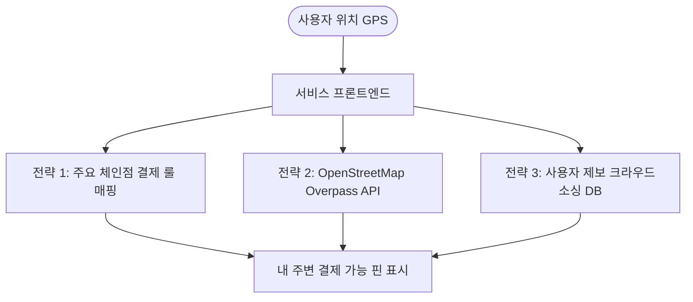

# 프로젝트 아이디어 목록

## 🏔️ 마운틴게이션 (Mountaigation) 무료 구현 기획서

> **개요**: 사용자 위치 기반 실시간 등산 안내, 경로 트래킹, 기상·안전 경고 및 완주 뱃지 시스템을 **100% 무료(Zero Cost)**로 구현하기 위한 종합 기술 기획서입니다.

---

### 1. 무료 구현 가능성 검토 결과

- **결론**: **100% 완전 무료로 구현 가능**
- 기존 `picture-grid`, `KakaoMAP`, `WeatherApp` 프로젝트처럼 별도의 유료 결제나 서버 비용 없이 **브라우저 표준 Web API + 오픈소스 라이브러리 + 무료 공공/오픈 API**만으로 완벽히 구축할 수 있습니다.

---

### 2. 기능별 무료 기술 및 데이터 소스 매핑

| 기능 | 권장 무료 기술 / 데이터 | 비용 및 무료 기준 |
| :--- | :--- | :--- |
| **현재 위치 & 고도 추적** | 브라우저 내장 `Geolocation API` (`watchPosition`) | **완전 무료** (스마트폰 내장 GPS/기압계 센서 활용) |
| **100m 내 산 감지 및 정보** | **공공데이터포털(data.go.kr) 산림청 API** 또는 **정적 JSON DB** (추천) | **완전 무료** (데이터를 앱 내 JSON으로 번들링 시 무제한/오프라인 가능) |
| **지도 및 경로(Polyline) 렌더링** | **Kakao Maps API** 또는 **Leaflet.js + OpenStreetMap** | **완전 무료** (카카오맵 Web 일 30만 건 무료 / Leaflet 완전 오픈소스) |
| **정상까지 남은 거리 계산** | **Turf.js** (오픈소스 지리 공간 분석 라이브러리) | **완전 무료** (클라이언트 브라우저에서 실시간 수학 연산) |
| **실시간 날씨 & 풍속 & 안전 경고** | **Open-Meteo API** (추천) 또는 기상청 단기예보 API | **완전 무료** (Open-Meteo는 API 키 등록 없이도 무제한에 준하는 무료 호출 가능) |
| **등산 통계 (거리, 시간, 휴식)** | 순수 **JavaScript 타이머 및 이동 속도 판정 알고리즘** | **완전 무료** (비용 0원, 사용자 기기에서 연산) |
| **등산 완주 뱃지 시스템** | 브라우저 `localStorage` 또는 `IndexedDB` | **완전 무료** (별도 서버 DB 없이 기기에 영구 보관) |

---

### 3. 핵심 기능별 세부 구현 방안

#### ① 100m 내 산 감지 및 정보 조회
- **구현 방식**:
  - 앱 실행 시 `navigator.geolocation.getCurrentPosition()`으로 현재 위도·경도를 획득합니다.
  - 국내 주요 산(명산 100대 등)의 **산 이름, 정상 좌표, 고도, 추천 등산로 입구(들머리) 좌표**를 담은 `mountains.json` 파일을 앱 내에 구성합니다.
  - 현재 위치와 각 산의 들머리/영역 간 거리를 하버사인(Haversine) 공식으로 계산하여 100m 이내에 들어오면 해당 산의 정보 카드를 화면에 표시합니다.
- **💡 실전 팁**: 산은 면적이 수 km에 달하므로, '산 정상 좌표' 기준 100m가 아닌 **'등산로 입구(들머리)' 좌표 기준 100m** 또는 **'산 반경 영역(1~2km)' 진입 기준**으로 판정해야 입구에서 정상적으로 감지됩니다.

#### ② 등산 시작 ("출발" 버튼)
- 사용자가 [출발] 버튼을 누르면:
  1. `startTime = Date.now()`로 등산 시작 시각을 기록합니다.
  2. `navigator.geolocation.watchPosition()`을 활성화하여 이동 경로를 실시간 배열(`trackingPath = []`)에 수집하기 시작합니다.
  3. **Screen Wake Lock API**(`navigator.wakeLock.request('screen')`)를 호출하여 등산 중 화면이 자동으로 꺼지지 않도록 설정합니다.

#### ③ 실시간 트래킹 & 안전 정보 안내
- **실시간 위치 및 고도**:
  - GPS로부터 `coords.latitude`, `coords.longitude`, `coords.altitude`(기기 지원 시)를 지속 수신합니다.
  - 고도 센서가 미지원되는 기기는 무료 `Open-Elevation API`에 좌표를 넘겨 해발 고도를 보정받을 수 있습니다.
- **정상까지 남은 거리**:
  - `turf.distance(currentPos, summitPos, {units: 'kilometers'})`를 통해 실시간으로 정상까지 직선 거리(또는 등산로 노드 경로 거리)를 계산하여 갱신합니다.
- **풍속, 날씨 및 안전 경고**:
  - `Open-Meteo` API 호출: `https://api.open-meteo.com/v1/forecast?latitude={lat}&longitude={lon}&current_weather=true`
  - 현재 기온, 날씨 코드(비/눈/안개), 풍속(km/h, m/s), 돌풍(gusts) 정보를 주기적으로 폴링(예: 10분 주기).
  - **안전 경고 로직**:
    - 풍속 ≥ 10m/s: *"⚠️ 강풍 주의: 능선 통과 시 바람에 유의하세요!"*
    - 강수 감지: *"🌧️ 비/눈 예보: 바위 및 등산로 미끄럼 주의!"*
    - 일몰 1시간 전: *"🔦 일몰 임박: 헤드랜턴을 점검하고 하산을 준비하세요!"*

#### ④ 등산 종료 ("도착" 버튼) 및 경로 Line(Polyline) 표시
- 사용자가 [도착] 버튼을 누르면:
  1. `watchPosition` 감시를 중지(`clearWatch`)하고 총 시간을 계산합니다.
  2. 수집된 `trackingPath` 좌표 배열을 카카오맵(`kakao.maps.Polyline`) 또는 Leaflet(`L.polyline`)을 통해 지도 위에 색상 선으로 렌더링합니다.
  3. 시작 지점(출발 마커)과 종료 지점(도착 마커)을 지도에 함께 표시합니다.

#### ⑤ 등산 기록 통계 분석
- **총 등산 거리**: 좌표 간 유클리드/하버사인 거리의 누적 총합 (km).
- **총 소요 시간**: `(endTime - startTime)`을 시/분/초 형식으로 변환.
- **휴식 시간 계산**:
  - 이전 위치와 현재 위치의 이동 거리를 시간 간격으로 나눈 속도가 일정 임계값(예: 0.5 km/h 미만)으로 2분 이상 지속되면 '휴식 중'으로 판정하여 휴식 누적 시간에 합산합니다.
- **순수 이동 시간**: `총 소요 시간 - 휴식 시간`.

#### ⑥ 정상 완주 판정 & "등산 완료" 뱃지 부여
- **완주 판정 로직**:
  - 등산 도중 또는 종료 시, **정상 좌표와의 거리가 30m 이내**로 들어온 적이 있다면 정상 등정에 성공한 것으로 판정합니다.
- **뱃지 보관함**:
  - 브라우저 `localStorage`에 완주 산 ID, 날짜, 소요 시간, 완주 뱃지 데이터를 영구 저장합니다.
  - 예: `localStorage.setItem('badge_gwanaksan', JSON.stringify({ completed: true, date: '2026-09-03', time: '02:35:10' }))`
  - 마이페이지/뱃지 보관함 탭에서 획득한 산 뱃지 목록을 시각적으로 확인 가능.

---

### 4. 추천 기술 스택 구성안

```
[클라이언트 웹앱] (React + Vite + PWA)
  ├── UI 프레임워크: React, Tailwind CSS (또는 바닐라 CSS)
  ├── PWA 지원: vite-plugin-pwa (오프라인 캐싱, 홈 화면 설치 지원)
  ├── 지도 렌더링: 카카오맵 Web SDK (kakaomap.js) 또는 Leaflet.js
  ├── 지리 공간 연산: Turf.js (거리 계산 및 폴리라인 처리)
  ├── 기상 데이터: Open-Meteo REST API (무료, API 키 불필요)
  ├── 화면 꺼짐 방지: Screen Wake Lock API (표준 브라우저 API)
  ├── 산 정보 데이터: 로컬 정적 JSON 파일 (mountains.json)
  └── 상태 및 뱃지 저장: Web LocalStorage / IndexedDB
```

---

### 5. 모바일 구현 기술 비교 및 최적 솔루션 (PWA vs React Native)

등산 중 실시간 위치 확인 및 내비게이션 활용을 위해 **스마트폰 모바일 환경**이 필수적입니다.

#### 🏆 1순위 추천: React + Vite + PWA (모바일 웹앱)
스마트폰 브라우저(크롬, 사파리)로 접속한 뒤 **"홈 화면에 추가"**를 통해 실제 앱스토어 앱처럼 아이콘을 생성하고 전체화면으로 실행하는 방식입니다.

- **선정 이유**:
  1. **비용 0원 (앱스토어 등록비 없음)**:
     - 일반 네이티브 앱은 공식 배포 시 애플 개발자(연 13만 원), 구글 플레이(1회 3만 원) 등록 비용이 발생합니다.
     - PWA는 GitHub Pages, Vercel 등에 무료 호스팅하여 URL/QR코드 하나로 본인 및 지인 모두 즉시 사용 가능합니다.
  2. **카카오맵 Web SDK 100% 호환**:
     - 카카오맵은 웹용 SDK 생태계가 가장 강력하며 일 30만 회 무료 호출을 안정적으로 활용할 수 있습니다.
  3. **기존 프로젝트 경험 활용**:
     - 기존에 작성하신 `KakaoMAP`, `WeatherApp`, `React` 프로젝트의 지식을 그대로 재활용하여 빠른 개발이 가능합니다.

- **모바일 웹의 제약 극복 방안**:
  - **제약**: 모바일 브라우저는 화면이 꺼지면 배터리 절약을 위해 GPS 추적을 일시 중단할 수 있습니다.
  - **해결책 1 (`Screen Wake Lock API`)**: 출발 버튼 클릭 시 화면이 자동으로 꺼지지 않도록 브라우저 화면 잠금을 유지합니다.
  - **해결책 2 (AMOLED 블랙 다크모드)**: 등산 중 화면을 켜두되 UI 배경을 완전한 블랙(`#000000`)으로 처리하여 OLED 디스플레이의 배터리 소모를 최소화합니다.

#### 🥈 2순위 대안: React Native (Expo) - 설치형 네이티브 앱
- **적용 고려 시점**: "스마트폰 화면을 완전히 끈 채 주머니에 넣고 4~5시간 연속으로 백그라운드 GPS를 기록해야 할 때"
- **특징 및 비용**:
  - `expo-location`을 통한 백그라운드 위치 추적 완벽 지원.
  - **본인 폰에 직접 설치 및 안드로이드 APK 파일 공유**: **완전 무료** (Expo Go 또는 무료 APK 빌드).
  - 단, 공식 앱스토어/플레이스토어 등록 시 개발자 계정 비용이 발생하며 웹 SDK에 비해 지도 설정 난이도가 다소 높습니다.

---

### 6. 실전 개발 시 권장 고려사항

1. **산속 음영 지역 (오프라인 대비)**:
   - 산에서는 통신(LTE/5G)이 일시적으로 끊길 수 있습니다.
   - PWA(Service Worker)와 정적 산 데이터(JSON)를 활용하면, **인터넷 연결이 끊겨도 순수 GPS 신호만으로 등산로 추적, 남은 거리 계산, 완주 뱃지 부여가 100% 정상 작동**합니다.
2. **배터리 소모 최적화**:
   - GPS를 1초마다 지속 폴링하면 배터리 소모가 커질 수 있으므로 `watchPosition`의 `maximumAge` 옵션이나 3~5초 단위 샘플링 필터를 두어 배터리를 절약합니다.
3. **PWA(홈 화면 추가) 지원**:
   - 매니페스트(`manifest.json`)를 등록하면 모바일 브라우저에서 '홈 화면에 앱 추가'를 통해 앱스토어 설치 앱처럼 전체화면으로 쾌적하게 사용할 수 있습니다.

---

## 해외 간편결제 지도 서비스 기획 및 개발 가이드
> **일본·대만 여행객을 위한 내 주변 현대카드 애플페이 / 카카오페이 / 네이버페이 사용처 찾기**

---

### 1. 프로젝트 개요

#### 1.1 기획 배경 및 목적
* **문제점**: 해외 여행(특히 일본, 대만) 시 국내 간편결제(현대카드 애플페이, 카카오페이, 네이버페이)의 사용처가 명확하지 않아 현금이나 실물 카드를 불필요하게 환전/준비하는 경우가 많음.
* **목표**: 현재 내 위치(GPS)를 기반으로 주변에서 **현대카드 애플페이(EMV 터치결제)**, **카카오페이(Alipay+)**, **네이버페이(Alipay+/UnionPay)**를 사용할 수 있는 매장을 한눈에 확인할 수 있는 무료 웹 서비스(PWA) 구축.
* **비용 목표**: 외부 유료 API(Google Places 등)나 유료 서버 없이 **100% 무료(Free Tier & 오픈소스)**로 개발 및 운영.

---

### 2. 결제 수단별 해외 작동 원리 분석

국내 결제사(현대카드, 카카오, 네이버)는 해외 가맹점의 실시간 위치 API를 외부 개발자에게 공개하지 않습니다. 따라서 **각 결제 수단이 해외에서 어떤 망(Network)을 통해 결제되는지**를 파악하고 이를 기반으로 데이터를 매핑해야 합니다.

| 결제 수단 | 해외 동작 네트워크 | 일본 현지 적용 | 대만 현지 적용 |
| :--- | :--- | :--- | :--- |
| **현대카드 애플페이** | **EMV Contactless**<br>(Visa/Mastercard 터치결제) | 편의점, 백화점, 체인점, 일부 교통(전철 터치 결제) | 편의점, MRT(일부), 쇼핑몰, 대형마트 |
| **카카오페이** | **Alipay+ (알리페이플러스)** | **PayPay** 제휴 매장 (가맹점 QR 또는 매장 로고 확인) | Alipay+ 가맹점, 편의점, 야시장 일부 |
| **네이버페이** | **Alipay+** 및 **UnionPay QR** | **PayPay** 제휴 매장 (Alipay+ 연동) 및 은련 QR 제휴처 | Alipay+ 가맹점, UnionPay 제휴처 |

> [!NOTE]
> **일본의 결제 방식 주의점**: 일본 로컬 비접촉 결제(iD, QUICPay)는 국내 발급 현대카드 애플페이로는 결제되지 않습니다. 반드시 **NFC 비접촉 결제 마크(와이파이 누운 모양)** 또는 **"クレジットカードのタッチ決済(신용카드 터치 결제)"**가 지원되는 매장이어야 합니다.

---

### 3. 데이터 확보 및 무료 구현 전략

공식 가맹점 위치 API가 없더라도 관광객이 주로 이용하는 장소의 80~90%를 커버할 수 있는 3단계 전략입니다.



#### 전략 1. 주요 체인점 결제 룰 매핑 (가장 효과적 ⭐⭐⭐)
일본과 대만의 대형 체인점(편의점, 드럭스토어, 패스트푸드 등)은 **본사 정책에 따라 전 지점의 결제 수단이 일괄 통일**되어 있습니다.
* **데이터 사전 정의**: 체인 브랜드명과 결제 가능 여부를 정적 JSON으로 관리합니다.
* **체인점 예시 (일본)**:
  * **편의점**: 세븐일레븐, 로손, 패밀리마트 (애플페이 O, 카카오페이 O, 네이버페이 O)
  * **드럭스토어**: 돈키호테, 마츠모토키요시, 선드럭 (애플페이 O, 카카오페이 O, 네이버페이 O)
  * **식음료**: 맥도날드, 스타벅스, 스키야, 요시노야, 마츠야
* **체인점 예시 (대만)**:
  * 세븐일레븐, 패밀리마트(전가), PX Mart(전련복리중심), 까르푸, 딘타이펑 등

#### 전략 2. OpenStreetMap(OSM) & Overpass API (완전 무료)
* OpenStreetMap은 전 세계 오픈소스 지도 데이터로, 상업적 이용 및 무료 조회가 가능합니다.
* **Overpass API**를 사용해 사용자 위치 반경(예: 1km) 내의 상점 및 결제 태그를 무료 쿼리할 수 있습니다:
  * `payment:contactless=yes` (비접촉 결제 / 애플페이)
  * `payment:alipay=yes` (알리페이 / 카카오페이 연동)
  * `brand=*` (브랜드 태그를 전략 1의 룰과 매칭)

#### 전략 3. 사용자 참여형 제보 (크라우드소싱)
* 로컬 식당, 개인 카페, 전통시장 상점 등은 사전 데이터 수집이 어렵기 때문에 사용자가 직접 "여기 네이버페이 결제 됨/안됨" 핀을 제보하고 리뷰를 남기도록 유도합니다.

---

### 4. 추천 기술 스택 (전부 무료 티어)

| 영역 | 기술/도구 | 비용 | 이유 및 설명 |
| :--- | :--- | :--- | :--- |
| **프론트엔드** | React / Vue / Vanilla JS (PWA) | **무료** | 앱스토어 심사 및 연간 개발자 등록비($99) 없이 모바일 웹앱으로 홈 화면에 설치 가능 |
| **지도 엔진** | **Leaflet.js** + **OpenStreetMap Tile** | **무료** | Google Maps와 달리 신용카드 등록 및 과금 위험이 전혀 없음 |
| **장소/POI 검색** | **Overpass API** (OpenStreetMap) | **무료** | 반경 기반 공간 쿼리 및 체인점 검색 무상 제공 |
| **백엔드 / DB** | **Supabase** 또는 **Firebase** (Free Tier) | **무료** | 사용자 제보 데이터 저장, 가맹점 캐시 저장 (월 50,000건 이상 무료) |
| **호스팅** | **Vercel** / **Cloudflare Pages** | **무료** | HTTPS 자동 적용 및 글로벌 CDN 무료 배포 |

---

### 5. 핵심 구현 예시 코드

#### 5.1 체인점 결제 수단 매핑 테이블 (`paymentRules.json`)
```json
{
  "brands": [
    {
      "id": "7eleven_jp",
      "name": "7-Eleven",
      "keywords": ["セブン-イレブン", "7-Eleven", "7-eleven"],
      "country": "JP",
      "apple_pay": true,
      "kakao_pay": true,
      "naver_pay": true,
      "note": "Alipay+/PayPay 결제 바코드 제시"
    },
    {
      "id": "lawson_jp",
      "name": "Lawson",
      "keywords": ["ローソン", "LAWSON", "Lawson"],
      "country": "JP",
      "apple_pay": true,
      "kakao_pay": true,
      "naver_pay": true,
      "note": "신용카드 터치결제 및 PayPay 바코드 지원"
    },
    {
      "id": "donki_jp",
      "name": "Don Quijote",
      "keywords": ["ドン・キホーテ", "Don Quijote"],
      "country": "JP",
      "apple_pay": true,
      "kakao_pay": true,
      "naver_pay": true,
      "note": "면세 카운터에서도 결제 가능"
    }
  ]
}
```

#### 5.2 Overpass API 쿼리 예시 (주변 편의점/마트 검색)
사용자 현재 좌표(위도 `lat`, 경도 `lng`) 반경 1,000m 내의 매장 검색:
```text
[out:json][timeout:25];
(
  node["shop"~"convenience|supermarket|chemist"](around:1000, {lat}, {lng});
  way["shop"~"convenience|supermarket|chemist"](around:1000, {lat}, {lng});
  node["amenity"~"fast_food|cafe|restaurant"]["brand"](around:1000, {lat}, {lng});
);
out center;
```

#### 5.3 사용자 위치 기반 Leaflet 지도 초기화 (자바스크립트)
```javascript
// 1. 현재 사용자 GPS 위치 가져오기
navigator.geolocation.getCurrentPosition(
  (position) => {
    const lat = position.coords.latitude;
    const lng = position.coords.longitude;

    // 2. Leaflet 무료 지도 생성
    const map = L.map('map').setView([lat, lng], 16);

    // 3. OpenStreetMap 무료 타일 레이어 추가
    L.tileLayer('https://{s}.tile.openstreetmap.org/{z}/{x}/{y}.png', {
      attribution: '&copy; OpenStreetMap contributors'
    }).addTo(map);

    // 4. 내 위치 마커 표시
    L.marker([lat, lng]).addTo(map).bindPopup('내 위치').openPopup();

    // 5. Overpass API 호출하여 주변 결제 가능 매장 핀 꽂기
    fetchNearbyStores(lat, lng, map);
  },
  (error) => {
    console.error("GPS 권한 에러:", error);
  }
);
```

---

### 6. 단계별 개발 로드맵

1. **1단계 (기본 프로토타입)**
   * Leaflet.js 기반 지도 UI 띄우기
   * HTML5 Geolocation으로 현재 위치 표시 (테스트 시 도쿄/타이베이 좌표로 가상 설정)
   * 일본 주요 10대 브랜드(편의점 3사, 돈키호테, 맥도날드 등) 정적 데이터 매핑
2. **2단계 (Overpass API 연동)**
   * 내 주변 500m~1km 내의 OSM POI 실시간 호출 및 브랜드 필터링
   * 필터 UI 제작: [애플페이만 보기] [카카오페이만 보기] [네이버페이만 보기]
3. **3단계 (사용자 제보 및 DB 연동)**
   * Supabase 무료 DB 생성
   * 사용자가 신규 장소를 탭하여 "결제 가능 여부 제보" 남기기 기능 추가
4. **4단계 (배포)**
   * Vercel / GitHub Pages를 통한 무료 웹 호스팅 및 모바일 PWA 지원

---

### 7. 결론
* **실현 가능성**: 해외 위치 기반 서비스는 전 세계 표준 규격(GPS, OpenStreetMap, EMV/Alipay 망)을 기반으로 하므로 한국에서 원격으로도 충분히 개발할 수 있습니다.
* **비용**: 완전 **무료(0원)**로 서비스 런칭 및 운영이 가능합니다.

---

## 목차

1. [사진·영상 분위기 보정 서비스](#1-사진영상-분위기-보정-서비스)
2. [AI 방 구조 및 가구 배치 추천 서비스](#2-ai-방-구조-및-가구-배치-추천-서비스)
3. [AI 여행 일정 자동 설계 서비스](#3-ai-여행-일정-자동-설계-서비스)
4. [Chat Tone Converter](#4-chat-tone-converter)
5. [AI 식단 및 음식 추천 서비스](#5-ai-식단-및-음식-추천-서비스)
6. [중고거래 판매글 작성 도우미](#6-중고거래-판매글-작성-도우미)
7. [PDF 요약 및 학습 보조 서비스](#7-pdf-요약-및-학습-보조-서비스)
8. [AI 자막 번역 및 자연스러운 표현 변환 서비스](#8-ai-자막-번역-및-자연스러운-표현-변환-서비스)
9. [소상공인 업무 자동화 도우미](#9-소상공인-업무-자동화-도우미)
10. [메모 및 대화 속 할 일 추출 서비스](#10-메모-및-대화-속-할-일-추출-서비스)
11. [AI 이력서 및 자기소개서 도우미](#11-ai-이력서-및-자기소개서-도우미)
12. [AI 전화 응대 도우미](#12-ai-전화-응대-도우미)
13. [주택 임대차 계약 확인 도우미](#13-주택-임대차-계약-확인-도우미)
14. [병원 대기 및 주변 약국 탐색 서비스](#14-병원-대기-및-주변-약국-탐색-서비스)
15. [시니어 디지털 생활 도우미](#15-시니어-디지털-생활-도우미)

---

## 1. 사진·영상 분위기 보정 서비스

### 개발 이유
사진이나 영상의 색감은 콘텐츠의 분위기와 완성도에 큰 영향을 준다. 하지만 원하는 색감을 직접 구현하려면 보정 도구 사용법과 색상 조정에 대한 지식이 필요하다.

### 개발 의도
사용자가 원하는 분위기의 참고 이미지나 영상 링크를 입력하면 해당 분위기를 분석하고, 자신의 사진이나 영상에도 비슷한 색감을 적용할 수 있도록 돕는다.

### 주요 기능
- 참고 이미지 업로드 및 분석
- 참고 이미지의 색감과 분위기 추출
- 밝기, 대비, 채도, 색온도 등 보정값 추천
- 사용자가 업로드한 사진의 자동 색감 보정
- 보정 전후 비교 기능
- 보정 결과 다운로드
- 영상 색감 보정 기능 확장

### 사람들에게 필요한 이유
- 사진 보정 기술이 부족한 사람도 원하는 분위기를 쉽게 구현할 수 있다.
- SNS 콘텐츠 제작 시간을 줄일 수 있다.
- 여러 사진의 색감을 일관성 있게 유지할 수 있다.

### 기대 효과
- 사진 및 영상 편집 진입 장벽 감소
- 콘텐츠 제작 시간 단축
- 개인의 취향에 맞는 색감 구현
- 향후 크리에이터를 위한 편집 도구로 확장 가능

### 개발 도구 및 기술
| 구분 | 기술 |
|---|---|
| Frontend | React, TypeScript |
| Styling | Tailwind CSS |
| Image Processing | Canvas API, WebGL |
| Image Analysis | OpenCV.js |
| Backend | Python, FastAPI |
| AI | 오픈소스 이미지 분석 모델 |
| Deployment | Vercel, Render |

### 무료 개발 전략
- 브라우저에서 처리할 수 있는 이미지 보정 기능부터 구현한다.
- 무료 오픈소스 라이브러리를 활용한다.
- 유료 AI API 대신 로컬 처리 및 무료 공개 모델을 우선 검토한다.

### MVP 범위
1. 이미지 업로드
2. 기본 색감 분석
3. 보정값 추천
4. 보정값 적용 및 결과 비교
5. 이미지 다운로드

---

## 2. AI 방 구조 및 가구 배치 추천 서비스

### 개발 이유
방을 새롭게 꾸미거나 가구를 배치할 때 공간의 크기와 구조를 고려해야 한다. 하지만 일반 사용자는 가구 배치에 대한 전문 지식이 부족하고, 실제로 배치하기 전까지 결과를 예상하기 어렵다.

### 개발 의도
사용자가 방 사진을 업로드하면 방의 구조와 공간을 분석하고, 실용성과 디자인을 고려한 가구 배치 및 인테리어를 추천한다.

### 주요 기능
- 방 사진 업로드
- 방 구조 및 공간 분석
- 가구 배치 추천
- 인테리어 스타일 추천
- 가구 크기와 공간 활용도 고려
- 가구 배치 시뮬레이션
- 풍수지리 요소를 고려한 배치 옵션
- 추천 결과 이미지 저장

### 사람들에게 필요한 이유
- 인테리어 전문가의 도움 없이 방을 꾸밀 수 있다.
- 가구 구매 전 배치 결과를 미리 확인할 수 있다.
- 좁은 공간을 효율적으로 활용할 수 있다.

### 기대 효과
- 인테리어 계획 수립 시간 단축
- 불필요한 가구 구매 및 배치 변경 감소
- 개인 취향에 맞는 공간 구성
- 향후 가구 쇼핑 및 인테리어 플랫폼으로 확장 가능

### 개발 도구 및 기술
| 구분 | 기술 |
|---|---|
| Frontend | React, TypeScript |
| Styling | Tailwind CSS |
| Image Processing | OpenCV |
| Backend | Python, FastAPI |
| AI | 오픈소스 이미지 인식 모델 |
| 3D Visualization | Three.js |
| Deployment | Vercel, Render |

### 무료 개발 전략
- 이미지 업로드와 기본 공간 분석부터 구현한다.
- Three.js를 활용해 간단한 가구 배치 시각화를 구현한다.
- 무료 오픈소스 모델을 활용하고, 초기에는 AI 분석 기능을 제한한다.

### MVP 범위
1. 방 사진 업로드
2. 방 구조 및 크기 정보 입력
3. 기본 가구 배치 추천
4. 가구 배치 결과 시각화
5. 추천 결과 저장

---

## 3. AI 여행 일정 자동 설계 서비스

### 개발 이유
여행을 계획할 때 여행지, 이동 경로, 맛집, 관광지 등을 직접 검색하고 일정에 맞게 조합해야 한다. 특히 처음 방문하는 지역에서는 효율적인 동선을 구성하기 어렵다.

### 개발 의도
사용자가 여행 지역과 날짜를 입력하면 관광지, 맛집, 이동 거리 등을 고려해 최적화된 여행 일정을 자동으로 생성한다.

### 주요 기능
- 여행 지역 및 날짜 입력
- 여행 스타일 및 선호도 설정
- 관광지 추천
- 현지 맛집 및 숨은 맛집 추천
- 식사 시간에 맞춘 음식점 배치
- 최적의 이동 경로 계산
- 날짜별 여행 일정 자동 생성
- 지도 기반 일정 확인
- 일정 수정 및 저장

### 사람들에게 필요한 이유
- 여행 계획을 세우는 데 드는 시간을 줄일 수 있다.
- 이동 동선을 고려한 효율적인 여행이 가능하다.
- 유명 관광지뿐 아니라 현지 맛집도 발견할 수 있다.

### 기대 효과
- 여행 계획 수립 과정 간소화
- 이동 시간 및 비용 절약
- 개인 취향에 맞는 여행 경험 제공
- 향후 여행 일정 공유 및 커뮤니티 기능으로 확장 가능

### 개발 도구 및 기술
| 구분 | 기술 |
|---|---|
| Frontend | React, TypeScript |
| Styling | Tailwind CSS |
| Map | Kakao Maps API 또는 Google Maps API |
| Backend | Node.js, Express |
| Database | Supabase |
| AI | 무료 사용량이 제공되는 AI API 또는 오픈소스 모델 |
| Deployment | Vercel, Render |

### 무료 개발 전략
- 무료 사용량이 제공되는 지도 API를 활용한다.
- 공개 관광 데이터와 무료 데이터 API를 활용한다.
- AI 기능은 무료 사용량이나 로컬 모델을 활용하는 방식으로 구현한다.

### MVP 범위
1. 여행 지역 및 날짜 입력
2. 관광지와 음식점 데이터 수집
3. 날짜별 일정 자동 생성
4. 지도 기반 동선 표시
5. 일정 수정 및 저장

---

## 4. Chat Tone Converter

### 개발 이유
메신저에서 같은 내용이라도 표현 방식에 따라 상대방이 받아들이는 느낌이 달라질 수 있다. 특히 직장, 친구, 가족 등 관계에 따라 적절한 말투를 선택하기 어려운 경우가 있다.

### 개발 의도
사용자가 입력한 문장을 원하는 말투로 변환해 주고, 카카오톡과 같은 메신저에서 바로 사용할 수 있도록 키보드 형태로 제공한다.

### 주요 기능
- 입력 문장 말투 변환
- 정중한 말투, 친근한 말투, 간결한 말투 등 선택
- 상황과 관계에 맞는 표현 추천
- 문장 자연스럽게 다듬기
- 변환 결과 복사
- 스마트폰 키보드 확장 기능
- 자주 사용하는 말투 저장

### 사람들에게 필요한 이유
- 상황에 맞는 표현을 쉽게 찾을 수 있다.
- 메시지를 작성하는 시간을 줄일 수 있다.
- 의도와 다르게 전달되는 표현을 줄일 수 있다.

### 기대 효과
- 메신저 사용 편의성 향상
- 커뮤니케이션 부담 감소
- 다양한 상황에 맞는 표현 제공

### 개발 도구 및 기술
| 구분 | 기술 |
|---|---|
| Mobile App | React Native |
| Language | TypeScript |
| Android Keyboard | Kotlin, InputMethodService |
| iOS Keyboard | Swift, Custom Keyboard Extension |
| Backend | Node.js 또는 Python |
| AI | 오픈소스 언어 모델 또는 무료 AI API |

### 무료 개발 전략
- React Native로 앱의 설정 및 사용자 인터페이스를 구현한다.
- Android 키보드는 Kotlin으로 별도 구현한다.
- iOS 키보드는 Swift 기반 확장 기능으로 구현한다.
- Expo Go만으로는 네이티브 키보드 확장을 구현할 수 없으므로 네이티브 개발 환경이 필요하다.

### MVP 범위
1. 문장 입력
2. 말투 선택
3. 문장 변환
4. 결과 복사
5. Android 키보드 확장 기능 구현

---

## 5. AI 식단 및 음식 추천 서비스

### 개발 이유
매일 무엇을 먹을지 결정하는 것은 생각보다 많은 시간과 고민이 필요한 일이다. 개인의 취향이나 보유 식재료를 고려한 음식 추천 서비스가 필요하다.

### 개발 의도
사용자의 취향, 식재료, 식사 목적 등을 바탕으로 적절한 음식과 식단을 추천한다.

### 주요 기능
- 음식 취향 설정
- 보유 식재료 입력
- 재료 기반 음식 추천
- 간단한 조리법 제공
- 주간 식단 구성
- 음식별 예상 조리 시간 표시
- 식재료 소비 기한 관리

### 사람들에게 필요한 이유
- 식사 메뉴를 결정하는 시간을 줄일 수 있다.
- 보유 식재료를 효율적으로 활용할 수 있다.
- 식재료 낭비를 줄일 수 있다.

### 기대 효과
- 식생활 관리 편의성 향상
- 식재료 낭비 감소
- 개인 취향에 맞는 음식 발견

### 개발 도구 및 기술
- Frontend: React, TypeScript
- Styling: Tailwind CSS
- Backend: Node.js, Express
- Database: Supabase
- AI: 오픈소스 모델 또는 무료 AI API

### MVP 범위
1. 음식 취향 입력
2. 식재료 입력
3. 음식 추천
4. 조리법 제공
5. 즐겨찾기 기능

---

## 6. 중고거래 판매글 작성 도우미

### 개발 이유
중고거래를 할 때 상품 설명을 작성하거나 적절한 가격을 정하는 과정이 번거롭다. 특히 판매 경험이 적은 사람은 상품의 특징을 효과적으로 설명하기 어렵다.

### 개발 의도
상품 사진과 기본 정보를 입력하면 판매글을 자동으로 작성하고, 가격 및 설명 작성에 도움을 제공한다.

### 주요 기능
- 상품 사진 업로드
- 상품명 및 상태 입력
- 판매글 자동 작성
- 상품 특징 요약
- 가격 참고 정보 제공
- 판매글 문체 변경
- 거래 시 주의사항 안내

### 사람들에게 필요한 이유
- 판매글 작성 시간을 줄일 수 있다.
- 상품의 장점을 효과적으로 전달할 수 있다.
- 중고거래 초보자도 쉽게 판매글을 작성할 수 있다.

### 기대 효과
- 중고거래 편의성 향상
- 판매글 품질 개선
- 판매 준비 시간 단축

### 개발 도구 및 기술
- Frontend: React, TypeScript
- Backend: Node.js
- AI: 무료 AI API 또는 오픈소스 언어 모델
- Database: Supabase

### MVP 범위
1. 상품 정보 입력
2. 상품 상태 입력
3. 판매글 자동 생성
4. 문체 수정
5. 결과 복사

---

## 7. PDF 요약 및 학습 보조 서비스

### 개발 이유
많은 양의 PDF 문서를 읽고 핵심 내용을 파악하는 데 시간이 오래 걸린다. 학습이나 업무에 필요한 정보를 빠르게 찾을 수 있는 도구가 필요하다.

### 개발 의도
PDF를 업로드하면 핵심 내용을 요약하고, 문서에 대한 질문과 답변을 제공하는 학습 보조 서비스를 만든다.

### 주요 기능
- PDF 업로드
- 문서 내용 추출
- 핵심 내용 요약
- 목차 및 주요 키워드 생성
- 문서 기반 질문과 답변
- 핵심 내용으로 퀴즈 생성
- 중요 페이지 및 문장 저장

### 사람들에게 필요한 이유
- 긴 문서를 빠르게 파악할 수 있다.
- 학습 내용을 효율적으로 복습할 수 있다.
- 문서에서 필요한 정보를 쉽게 찾을 수 있다.

### 기대 효과
- 문서 분석 시간 단축
- 학습 효율 향상
- 업무 자료 활용도 증가

### 개발 도구 및 기술
- Frontend: React, TypeScript
- Backend: Python, FastAPI
- PDF Processing: PyMuPDF
- AI: 오픈소스 언어 모델
- Database: Supabase

### MVP 범위
1. PDF 업로드
2. 텍스트 추출
3. 문서 요약
4. 문서 기반 질문 기능
5. 요약 결과 저장

---

## 8. AI 자막 번역 및 자연스러운 표현 변환 서비스

### 개발 이유
일반적인 번역기는 문맥이나 상황에 맞지 않는 어색한 표현을 생성하는 경우가 있다. 특히 영상 자막은 짧은 문장 안에서 자연스러운 의미 전달이 중요하다.

### 개발 의도
자막을 입력하거나 업로드하면 문맥을 고려해 자연스럽게 번역하고, 사용자가 원하는 표현 방식으로 수정한다.

### 주요 기능
- 자막 파일 업로드
- 자막 텍스트 추출
- 다국어 번역
- 자연스러운 표현으로 수정
- 문맥 기반 번역
- 자막 길이 조절
- SRT 파일 다운로드

### 사람들에게 필요한 이유
- 번역 과정에서 발생하는 어색한 표현을 줄일 수 있다.
- 영상 자막 제작 시간을 단축할 수 있다.
- 외국어 콘텐츠를 더 자연스럽게 이해할 수 있다.

### 기대 효과
- 자막 제작 편의성 향상
- 번역 품질 개선
- 콘텐츠 접근성 향상

### 개발 도구 및 기술
- Frontend: React, TypeScript
- Backend: Python, FastAPI
- File Processing: Python
- AI: 오픈소스 번역 모델 또는 무료 AI API

### MVP 범위
1. SRT 파일 업로드
2. 자막 텍스트 추출
3. 번역 및 자연스러운 표현 변환
4. 자막 미리보기
5. SRT 다운로드

---

## 9. 소상공인 업무 자동화 도우미

### 개발 이유
소상공인은 고객 응대, 홍보 문구 작성, 예약 관리 등 다양한 업무를 직접 처리해야 한다. 반복적인 업무에 많은 시간을 소비하는 문제를 해결할 필요가 있다.

### 개발 의도
반복적인 업무를 간단하게 자동화하고, 홍보 및 고객 응대에 필요한 콘텐츠를 생성하는 도구를 제공한다.

### 주요 기능
- 홍보 문구 자동 작성
- SNS 게시물 작성
- 고객 문의 답변 초안 생성
- 공지사항 작성
- 업무 일정 관리
- 자주 사용하는 답변 저장

### 사람들에게 필요한 이유
- 반복 업무를 줄일 수 있다.
- 전문적인 마케팅 지식 없이도 홍보 콘텐츠를 만들 수 있다.
- 고객 응대 시간을 단축할 수 있다.

### 기대 효과
- 업무 효율성 향상
- 홍보 콘텐츠 제작 부담 감소
- 소상공인의 디지털 업무 접근성 향상

### 개발 도구 및 기술
- Frontend: React, TypeScript
- Backend: Node.js
- Database: Supabase
- AI: 오픈소스 언어 모델 또는 무료 AI API

### MVP 범위
1. 업종 및 사업 정보 입력
2. 홍보 문구 생성
3. 고객 응대 문구 생성
4. 결과 저장
5. 문구 복사

---

## 10. 메모 및 대화 속 할 일 추출 서비스

### 개발 이유
대화나 메모에는 일정, 요청사항, 해야 할 일 등이 섞여 있다. 중요한 내용을 놓치거나 별도로 정리하지 못하는 경우가 많다.

### 개발 의도
사용자가 입력한 메모나 대화 내용을 분석해 할 일과 일정, 중요한 정보를 자동으로 추출한다.

### 주요 기능
- 텍스트 입력
- 할 일 자동 추출
- 일정 및 마감일 추출
- 중요도 분류
- 체크리스트 자동 생성
- 캘린더 연동
- 완료 여부 관리

### 사람들에게 필요한 이유
- 중요한 할 일을 놓칠 가능성을 줄일 수 있다.
- 메모를 다시 읽고 정리하는 시간을 줄일 수 있다.
- 개인 업무와 일정을 효율적으로 관리할 수 있다.

### 기대 효과
- 업무 및 일정 관리 효율 향상
- 정보 정리 시간 단축
- 생산성 향상

### 개발 도구 및 기술
- Frontend: React, TypeScript
- Backend: Node.js
- Database: Supabase
- AI: 오픈소스 언어 모델 또는 무료 AI API

### MVP 범위
1. 텍스트 입력
2. 할 일 및 일정 추출
3. 체크리스트 생성
4. 완료 상태 관리
5. 데이터 저장

---

## 11. AI 이력서 및 자기소개서 도우미

### 개발 이유
취업 준비 과정에서 이력서와 자기소개서를 작성하는 것은 많은 시간과 노력이 필요한 일이다. 자신의 경험을 효과적으로 정리하고 표현하는 데 어려움을 겪는 사람도 많다.

### 개발 의도
사용자의 경험과 지원 직무를 바탕으로 이력서 및 자기소개서 작성을 돕고, 문장을 개선하는 서비스를 만든다.

### 주요 기능
- 경험 및 프로젝트 정보 입력
- 직무별 자기소개서 작성 보조
- 문장 다듬기
- 핵심 역량 추출
- 프로젝트 설명 개선
- 이력서 템플릿 제공
- PDF 출력

### 사람들에게 필요한 이유
- 자신의 경험을 구조적으로 정리할 수 있다.
- 자기소개서 작성 부담을 줄일 수 있다.
- 직무에 적합한 역량을 효과적으로 표현할 수 있다.

### 기대 효과
- 취업 준비 시간 단축
- 문서 작성 품질 향상
- 취업 준비 과정의 효율성 향상

### 개발 도구 및 기술
- Frontend: React, TypeScript
- Backend: Node.js
- Document Generation: PDF 라이브러리
- Database: Supabase
- AI: 오픈소스 언어 모델 또는 무료 AI API

### MVP 범위
1. 사용자 경험 입력
2. 지원 직무 입력
3. 자기소개서 작성 보조
4. 문장 개선
5. PDF 출력

---

## 12. AI 전화 응대 도우미

### 개발 이유
전화 통화 중 내용을 놓치거나 상대방의 말을 정확하게 이해하지 못하는 경우가 있다. 전화 응대가 부담스러운 사람에게 실질적인 도움을 제공할 수 있다.

### 개발 의도
전화 통화 내용을 텍스트로 변환하고, 핵심 내용을 요약하거나 응대에 필요한 문장을 추천하는 서비스를 만든다.

### 주요 기능
- 음성 녹음 파일 업로드
- 음성 텍스트 변환
- 통화 내용 요약
- 핵심 요청사항 추출
- 후속 조치 및 일정 추출
- 답변 문장 추천

### 사람들에게 필요한 이유
- 통화 내용을 다시 확인할 수 있다.
- 중요한 요청사항을 놓치지 않을 수 있다.
- 전화 응대에 대한 부담을 줄일 수 있다.

### 기대 효과
- 통화 내용 관리 편의성 향상
- 업무 누락 방지
- 고객 응대 효율 향상

### 개발 도구 및 기술
- Frontend: React, TypeScript
- Backend: Python, FastAPI
- Speech-to-Text: Whisper
- AI: 오픈소스 언어 모델

### MVP 범위
1. 녹음 파일 업로드
2. 음성 텍스트 변환
3. 통화 내용 요약
4. 할 일 추출
5. 결과 저장

---

## 13. 주택 임대차 계약 확인 도우미

### 개발 이유
부동산 계약에는 복잡한 용어와 확인해야 할 항목이 많다. 특히 사회초년생이나 첫 자취를 시작하는 사람은 계약 과정에서 위험 요소를 파악하기 어렵다.

### 개발 의도
임대차 계약서의 주요 항목을 쉽게 설명하고, 계약 전 확인해야 할 사항을 체크리스트 형태로 제공한다.

### 주요 기능
- 계약서 파일 업로드
- 계약서 주요 내용 추출
- 어려운 법률 용어 설명
- 계약 전 확인사항 체크리스트
- 보증금 및 계약 기간 확인
- 주의가 필요한 항목 표시
- 관련 공공기관 정보 안내

### 사람들에게 필요한 이유
- 부동산 계약 경험이 적은 사람도 내용을 이해할 수 있다.
- 계약 전 확인해야 할 사항을 놓치지 않을 수 있다.
- 복잡한 계약 내용을 쉽게 파악할 수 있다.

### 기대 효과
- 부동산 계약 정보 접근성 향상
- 계약 관련 정보 비대칭 완화
- 사회초년생의 계약 준비 부담 감소

### 개발 도구 및 기술
- Frontend: React, TypeScript
- Backend: Python, FastAPI
- PDF Processing: PyMuPDF
- AI: 오픈소스 언어 모델
- Database: Supabase

### MVP 범위
1. 계약서 업로드
2. 주요 항목 추출
3. 계약 용어 설명
4. 체크리스트 제공
5. 주의사항 안내

> 주의: 이 서비스는 계약 내용을 이해하는 데 도움을 주는 보조 도구이며, 법률적 판단이나 전문가의 검토를 대체하지 않는다.

---

## 14. 병원 대기 및 주변 약국 탐색 서비스

### 개발 이유
병원을 방문할 때 대기 시간을 예측하기 어렵고, 진료 후 주변 약국을 찾는 과정도 번거롭다. 필요한 의료기관 정보를 한곳에서 확인할 수 있는 서비스가 필요하다.

### 개발 의도
사용자의 위치나 검색 지역을 기준으로 병원과 약국 정보를 제공하고, 이용에 필요한 정보를 쉽게 확인할 수 있도록 한다.

### 주요 기능
- 주변 병원 검색
- 주변 약국 검색
- 진료 시간 및 운영 정보 확인
- 지도 기반 위치 표시
- 병원별 정보 비교
- 길찾기 연동
- 즐겨찾기 기능

### 사람들에게 필요한 이유
- 필요한 의료기관을 빠르게 찾을 수 있다.
- 운영 시간과 위치를 쉽게 확인할 수 있다.
- 병원 방문과 약국 이용을 편리하게 계획할 수 있다.

### 기대 효과
- 의료기관 정보 접근성 향상
- 검색 및 이동 시간 단축
- 의료기관 이용 편의성 개선

### 개발 도구 및 기술
- Frontend: React, TypeScript
- Map: Kakao Maps API
- Backend: Node.js
- Database: Supabase
- Data: 공공데이터포털 API

### MVP 범위
1. 위치 또는 지역 검색
2. 주변 병원 및 약국 조회
3. 지도 표시
4. 운영 정보 확인
5. 길찾기 연동

---

## 15. 시니어 디지털 생활 도우미

### 개발 이유
스마트폰과 디지털 서비스가 일상생활에 깊이 들어왔지만, 디지털 기기 사용이 익숙하지 않은 사람에게는 여전히 복잡하고 어려운 기능이 많다.

### 개발 의도
스마트폰 및 온라인 서비스 사용법을 쉬운 설명과 단계별 안내로 제공하는 디지털 생활 도우미를 만든다.

### 주요 기능
- 스마트폰 기능 사용법 안내
- 앱 사용 방법 설명
- 단계별 가이드 제공
- 큰 글씨 및 간단한 UI
- 음성 안내
- 자주 묻는 질문 제공
- 상황별 도움말 검색

### 사람들에게 필요한 이유
- 디지털 기기 사용에 대한 부담을 줄일 수 있다.
- 주변 사람에게 매번 도움을 요청하지 않아도 된다.
- 디지털 서비스 접근성이 향상된다.

### 기대 효과
- 디지털 정보 격차 완화
- 시니어의 디지털 서비스 이용 편의성 향상
- 독립적인 디지털 생활 지원

### 개발 도구 및 기술
- Frontend: React, TypeScript
- Styling: Tailwind CSS
- Backend: Node.js
- Database: Supabase
- AI: 오픈소스 언어 모델
- Accessibility: 웹 접근성 표준 준수

### MVP 범위
1. 사용 목적 선택
2. 기능별 사용법 검색
3. 단계별 설명 제공
4. 큰 글씨 및 쉬운 UI
5. 음성 안내 기능

---

## 공통 개발 방향

### 1. 무료 개발을 위한 기본 원칙

개인 개발 프로젝트인 만큼 초기 개발 비용을 최소화하는 것을 목표로 한다.

- 오픈소스 라이브러리 우선 사용
- 무료 배포 플랫폼 활용
- 무료 데이터 API 활용
- 유료 AI API 의존도 최소화
- 가능한 기능은 브라우저 또는 사용자 기기에서 직접 처리
- 초기에는 핵심 기능만 구현하고 점진적으로 확장

### 2. 공통 기술 스택 후보

| 구분 | 기술 | 사용 목적 |
|---|---|---|
| Frontend | React | 사용자 인터페이스 개발 |
| Language | TypeScript | 안정적인 코드 작성 |
| Styling | Tailwind CSS | UI 스타일링 |
| Backend | Node.js, Express | 서버 및 API 개발 |
| Backend | Python, FastAPI | AI 및 데이터 처리 |
| Database | Supabase | 데이터 저장 및 인증 |
| Deployment | Vercel | 프론트엔드 배포 |
| Deployment | Render | 백엔드 배포 |
| Version Control | Git, GitHub | 버전 관리 및 협업 |

### 3. 개발 우선순위 선정 기준

프로젝트를 실제로 시작할 때는 다음 기준을 고려한다.

1. 핵심 기능을 빠르게 구현할 수 있는가?
2. 무료 기술과 오픈소스만으로 MVP를 만들 수 있는가?
3. 실제 사용자가 겪는 불편함을 해결하는가?
4. 개인 개발자가 유지보수할 수 있는 규모인가?
5. 향후 기능을 확장할 수 있는가?
6. 포트폴리오에서 기술적 역량을 보여줄 수 있는가?

### 4. 개발 시 주의사항

- 무료 API는 사용량 제한과 정책 변경 가능성을 고려한다.
- AI 기능은 비용과 응답 속도를 고려해 적용한다.
- 개인정보 및 업로드 파일은 안전하게 처리한다.
- 모바일과 데스크톱 환경 모두에서 사용성을 확인한다.
- 핵심 기능을 먼저 완성한 뒤 부가 기능을 추가한다.

---

## 🎣 온라인 멀티플레이 낚시 즐기기

> 평화로운 호수에서 다른 사람들과 함께 낚시를 즐기고, 때로는 예상치 못한 공포를 경험하는 1인칭 3D 온라인 낚시 게임으로 메타몽데브의 산사와 비슷한 유형의 서비스

## 1. 프로젝트 개요

### 서비스 소개

사용자들이 하나의 공용 낚시터에 접속해 다른 플레이어들과 함께 낚시를 즐길 수 있는 브라우저 기반 3D 멀티플레이 게임이다.   

생각을 비우고 강, 바다, 새, 바람 소리를 들으며 잠시동안 힐링의 시간을 보내는 것을 의도합니다.   

1인칭 시점에서 낚싯대와 미끼를 선택하고, 직접 낚싯줄을 던져 물고기를 잡는 경험을 제공한다.   

게임은 두 가지 모드로 구성된다.

- **힐링 모드:** 잔잔한 자연환경과 ASMR 사운드를 즐기며 편안하게 낚시할 수 있는 공간
- **공포 모드:** 기본적인 낚시 경험은 동일하지만, 무작위로 선정된 플레이어에게 물귀신이 등장하는 공포 이벤트가 발생하는 공간

평화로운 낚시 경험과 예상하지 못한 공포 요소를 결합해 기존 낚시 게임과 차별화된 경험을 제공하는 것이 목표다.

### 프로젝트 개발 목적

- 별도의 프로그램 설치 없이 웹 브라우저에서 즐길 수 있는 3D 낚시 게임 제작
- 혼자 낚시하는 것이 아닌 여러 사용자가 하나의 공간에서 함께 시간을 보내는 경험 제공
- 복잡한 경쟁이나 미션 없이도 편안하게 즐길 수 있는 힐링 콘텐츠 구현
- 평화로운 환경에 공포 요소를 결합해 색다른 재미 제공
- 3D 그래픽, 게임 로직, 실시간 멀티플레이를 직접 구현하며 개발 역량 확장

### 참고 서비스

- [SANSA](https://sansatemple.com/)

SANSA의 차분하고 감성적인 공간 연출을 참고하되, 독자적인 그래픽과 게임 시스템을 구현한다.

---

## 2. 핵심 사용자 경험

### ① 하나의 낚시터에서 함께 낚시하기

모든 사용자는 하나의 공용 낚시터에 접속한다.

- 별도의 방 생성이나 초대 없이 같은 공간에서 플레이
- 다른 플레이어들이 낚시하는 모습을 실시간으로 확인
- 다른 플레이어의 이름과 물고기 획득 수 확인
- 여러 사용자가 동시에 낚시 가능

### ② 직접 낚시하기

단순히 버튼을 누르는 방식이 아닌 실제 낚시 동작을 간소화한 조작 방식을 제공한다.

- 낚싯대 및 미끼 선택
- 마우스를 누르고 있는 시간에 따라 투척 파워 조절
- 마우스를 놓으면 낚싯줄 투척
- 찌의 움직임을 통해 입질 확인
- 스페이스바를 타이밍에 맞춰 눌러 물고기 낚아채기
- 물고기를 끌어올리고 획득

### ③ 편안하게 머무르기

낚시를 하지 않더라도 자연환경을 감상하며 편안하게 머무를 수 있도록 한다.

- 잔잔한 물소리
- 바람소리
- 새소리
- 자연스러운 물결과 주변 환경 애니메이션
- 차분한 색감과 3D 그래픽

### ④ 예상하지 못한 공포 경험

공포 모드에서는 평화로운 낚시 도중 특정 플레이어에게만 물귀신 이벤트가 발생한다.

- 이상 징후 발생
- 물귀신 등장
- 제한 시간 내 퇴치 시도
- 실패 시 점프스케어 발생
- 해당 플레이어의 보유 물고기 전부 몰수

---

## 3. 주요 기능

### 3-1. 메인 화면

- 서비스 로고 및 타이틀
- 힐링 모드 입장
- 공포 모드 입장
- 게임 설명
- 사운드 및 환경 설정

### 3-2. 1인칭 3D 낚시 환경

- 1인칭 시점
- 낚시 의자에 앉아 있는 상태로 시작
- 호수와 주변 자연환경 구현
- 마우스를 이용한 시점 조작
- 자연스러운 물결과 환경 애니메이션
- 낚싯대와 낚싯줄 표시

### 3-3. 낚시 시스템

**낚싯대 및 미끼**
- 낚싯대 선택
- 미끼 선택
- 낚싯대별 투척 거리 및 성능 확장
- 미끼별 입질 확률 및 물고기 출현 종류 확장

**캐스팅**
- 마우스 클릭 및 홀드로 투척 파워 조절
- 파워 게이지 표시
- 마우스를 놓으면 낚싯줄 투척
- 투척 파워에 따른 낚시 거리 변화

**입질 및 낚시**
- 무작위 입질 발생
- 찌의 움직임으로 입질 표현
- 스페이스바를 활용한 타이밍 판정
- 낚싯대를 당기는 애니메이션
- 물고기 획득 연출

### 3-4. 물고기 수집 시스템

초기 물고기 종류:

- 붕어
- 잉어
- 메기
- 송어
- 황금 물고기

물고기별 관리 정보:

- 물고기 ID
- 이름
- 외형
- 희귀도
- 출현 확률
- 획득 수량

추후 다양한 물고기와 희귀도를 추가할 수 있도록 설계한다.

### 3-5. 멀티플레이 시스템

- 하나의 공용 낚시터 운영
- 실시간 플레이어 접속 및 퇴장
- 다른 플레이어의 3D 캐릭터 표시
- 플레이어 이름 표시
- 낚시 진행 상태 동기화
- 물고기 획득 결과 동기화
- 플레이어별 물고기 획득 수 표시

초기에는 2~5명 동시 접속을 목표로 하고, 이후 10명 이상으로 확대한다.

### 3-6. 힐링 모드

- 평화로운 자연환경
- 잔잔한 물소리
- 새소리와 바람소리
- 물고기가 물 위로 튀어 오르는 연출
- 공포 이벤트 없음
- 낚시를 하지 않아도 편안하게 머무를 수 있는 공간

### 3-7. 공포 모드

**이벤트 발생**
- 서버가 무작위로 특정 플레이어를 선정
- 대상 플레이어에게만 공포 이벤트 발생
- 다른 플레이어는 기존 낚시를 계속 진행

**이상 징후**
- 주변 환경음 변화
- 새소리 중단
- 물속의 이상 현상
- 긴장감을 유발하는 효과음

**물귀신 등장**
- 물속에서 물귀신 출현
- 대상 플레이어에게만 시각 및 청각 효과 적용
- 제한 시간 내 퇴치 시도

**성공 및 실패**
- 성공: 물귀신 퇴치 및 정상 낚시 복귀
- 실패: 점프스케어 발생 및 해당 플레이어의 물고기 전부 몰수

**추후 확장**
- 공포 이벤트 생존 보상
- 특별 물고기
- 공포 이벤트 전용 칭호
- 다양한 물귀신 패턴

### 3-8. 물고기 도감 및 기록

- 물고기 도감
- 물고기별 획득 수량
- 물고기 희귀도
- 총 낚시 횟수
- 총 획득 물고기 수
- 가장 희귀한 물고기
- 공포 이벤트 성공 및 실패 기록

### 3-9. 환경 및 설정

- 배경음 음량 조절
- 효과음 음량 조절
- 마우스 감도 조절
- 화면 설정
- 공포 효과음 및 화면 흔들림 조절

---

## 4. 차별화 요소

| 구분 | 특징 |
|---|---|
| 공용 낚시터 | 모든 사용자가 하나의 공간에서 함께 낚시 |
| 1인칭 시점 | 직접 낚시하는 듯한 몰입감 |
| 힐링 경험 | 자연환경과 ASMR 중심의 편안한 플레이 |
| 공포 요소 | 평화로운 낚시 중 발생하는 예상치 못한 물귀신 이벤트 |
| 개인별 이벤트 | 공포 이벤트가 특정 플레이어에게만 발생 |
| 간단한 조작 | 마우스와 키보드만으로 즐길 수 있는 낚시 |

**핵심 차별점:**

평화로운 공간에서 다른 사람들과 함께 낚시를 즐기는 편안함과, 그 평화로움을 갑작스럽게 깨뜨리는 공포 경험을 하나의 게임에 결합한다.

---

## 5. 기술 스택

| 영역 | 기술 | 용도 |
|---|---|---|
| 프론트엔드 | React | UI 구성 |
| 언어 | TypeScript | 안정적인 코드 작성 |
| 개발 환경 | Vite | 프로젝트 실행 및 빌드 |
| 3D 그래픽 | Three.js | 3D 환경 및 오브젝트 |
| React 3D 연동 | React Three Fiber | React 기반 3D 렌더링 |
| 3D 유틸리티 | Drei | 카메라, 환경 및 3D 유틸리티 |
| 상태 관리 | Zustand | 게임 상태 관리 |
| 멀티플레이 | Colyseus | 실시간 동기화 |
| 서버 | Node.js | 게임 규칙 및 이벤트 관리 |
| 데이터베이스 | Supabase | 사용자 및 플레이 기록 |
| 배포 | Vercel 및 별도 서버 호스팅 | 서비스 배포 |
| 형상 관리 | GitHub | 코드 관리 |

무료 오픈소스와 무료 사용량이 제공되는 서비스를 우선 사용한다.

단, Colyseus 게임 서버를 실행할 수 있는 호스팅은 별도로 필요하며 무료 플랜의 장기 실행 가능 여부와 사용량 제한을 확인해야 한다.

---

## 6. 개발 로드맵

### Phase 1. 프로젝트 초기 환경 구축
- React + TypeScript + Vite 설정
- 기본 폴더 구조 구성
- 메인 화면 제작
- 힐링 및 공포 모드 진입 UI

### Phase 2. 1인칭 3D 낚시터
- 호수 및 주변 자연환경
- 낚시 의자
- 1인칭 카메라
- 마우스 시점 조작
- 기본 환경 애니메이션

### Phase 3. 낚시 시스템
- 낚싯대 및 미끼 선택
- 마우스 홀드 기반 투척
- 투척 파워 및 거리 계산
- 입질 시스템
- 스페이스바 타이밍 판정
- 물고기 획득

### Phase 4. 힐링 모드
- 자연환경 사운드
- 물결 및 환경 애니메이션
- 낮과 저녁 연출
- UI 및 사운드 설정

### Phase 5. 멀티플레이
- Colyseus 서버 구축
- 공용 낚시터
- 플레이어 접속 및 퇴장
- 다른 플레이어 캐릭터 표시
- 실시간 낚시 상태 및 점수 동기화

### Phase 6. 공포 모드
- 공포 모드 구현
- 무작위 이벤트 대상 선정
- 물귀신 등장 연출
- 퇴치 시스템
- 점프스케어
- 물고기 몰수

### Phase 7. 수집 및 기록
- 물고기 도감
- 물고기 희귀도
- 획득 기록
- 게임 통계

### Phase 8. 데이터베이스 연동
- Supabase 연결
- 사용자 인증
- 게임 기록 저장
- 도감 데이터 저장

### Phase 9. 최적화 및 배포
- 3D 그래픽 최적화
- 메모리 및 네트워크 최적화
- 브라우저 테스트
- 동시 접속 테스트
- 웹 서비스 공개

---

## 7. 초기 MVP 범위

처음부터 모든 기능을 구현하지 않고 핵심적인 플레이 경험을 중심으로 개발한다.

### 필수 구현 기능

- [ ] 1인칭 3D 낚시터
- [ ] 낚시 의자 및 낚싯대
- [ ] 마우스 기반 투척 시스템
- [ ] 입질 및 낚시 성공 판정
- [ ] 물고기 5종
- [ ] 물고기 획득 수 표시
- [ ] 2~5명 공용 멀티플레이
- [ ] 힐링 모드
- [ ] 공포 모드
- [ ] 개인별 물귀신 이벤트
- [ ] 점프스케어 및 물고기 몰수

### 추후 확장 기능

- [ ] 회원가입 및 로그인
- [ ] 물고기 도감
- [ ] 다양한 낚싯대 및 미끼
- [ ] 희귀 물고기
- [ ] 날씨 변화
- [ ] 낮과 밤
- [ ] 계절 변화
- [ ] 플레이어 채팅
- [ ] 캐릭터 커스터마이징
- [ ] 랭킹 시스템
- [ ] 특별 이벤트

초기에는 로그인 없이 임시 닉네임으로 접속하는 방식을 사용해 개발 복잡도를 낮춘다.

---

## 8. 개발 시 고려사항

1. 싱글플레이 낚시 시스템을 먼저 완성한 후 멀티플레이를 구현한다.
2. 물고기 획득 및 공포 이벤트 결과는 서버에서 판정한다.
3. 클라이언트에서 임의로 점수나 물고기 수를 변경할 수 없도록 한다.
4. 3D 그래픽의 완성도보다 실제 플레이가 가능한 기능을 먼저 구현한다.
5. 기능별로 컴포넌트와 시스템을 분리해 유지보수성을 확보한다.
6. 무료 에셋을 사용할 때 라이선스를 확인한다.
7. 무료 서버의 동시 접속 및 네트워크 사용량 제한을 고려한다.
8. 각 개발 단계가 완료될 때마다 실제 브라우저에서 테스트한다.

---

## 9. 기대 효과

- 브라우저에서 간편하게 즐길 수 있는 새로운 형태의 온라인 낚시 경험 제공
- 혼자 또는 다른 사람들과 함께 즐길 수 있는 힐링 공간 제공
- 경쟁과 스트레스가 적은 느긋한 게임 플레이
- 공포 이벤트를 통한 예상하지 못한 재미와 긴장감
- 3D 웹 게임 및 실시간 멀티플레이 개발 경험 확보

---

## 10. 최종 목표

사용자가 웹사이트에 접속해 낚시 의자에 앉는 순간부터 자연스럽게 게임에 몰입할 수 있는 환경을 만드는 것이 최종 목표다.   

낚시를 통해 편안하게 시간을 보내고, 다른 플레이어들과 같은 공간에서 함께 머무르며, 때로는 예상하지 못한 공포를 경험하는 독특한 온라인 낚시 게임을 완성한다.

**핵심 개발 순서**

3D 낚시터 → 1인칭 시점 → 낚시 시스템 → 힐링 모드 → 멀티플레이 → 공포 모드 → 수집 시스템 → 최적화 및 배포

--

## 보신각 (BOSINGAK)

> 하나의 종을 울리기 위해 모인 사람들. 누군가는 종을 치고, 누군가는 기도하며, 누군가는 그 순간을 함께 바라본다.

## 1. 프로젝트 개요

### 1-1. 프로젝트 소개

보신각은 최대 100명의 플레이어가 하나의 가상 공간에 모여 종을 울리고, 기도하고, 서로의 순간을 공유하는 온라인 멀티플레이 힐링 서비스다.

플레이어는 보신각이 구현된 가상 공간에 접속해 자유롭게 이동할 수 있다. 중앙에 위치한 거대한 종 앞에서 줄을 잡으면 종 치기에 참여할 수 있으며, 최대 5명까지 동시에 참여할 수 있다.

종을 치지 않는 플레이어는 주변에서 종 치는 모습을 관람하거나 기도, 촛불 들기 등의 행동을 할 수 있다.

또한 실제 서울의 날씨와 시간 정보를 반영해 맑은 날에는 선명한 달을, 흐린 날에는 구름에 가려진 달을, 비나 눈이 내리는 날에는 그에 맞는 환경을 구현한다.

### 1-2. 프로젝트 목표

- 여러 사람이 하나의 공간에서 자연스럽게 교류하는 온라인 환경 구현
- 협동을 통해 하나의 종을 울리는 특별한 경험 제공
- 기도와 촛불 등을 활용한 자유로운 힐링 경험 제공
- 실제 날씨와 시간에 따라 변화하는 몰입감 있는 가상 공간 구현
- 복잡한 경쟁이나 순위 없이 누구나 편안하게 머무를 수 있는 서비스 제작

### 1-3. 핵심 콘셉트

- 장르: 온라인 멀티플레이 소셜 힐링 게임
- 플랫폼: PC 웹 브라우저
- 시점: 1인칭 또는 3인칭 (추후 확정)
- 서버 최대 인원: 100명
- 종 치기 참여 인원: 최소 1명 ~ 최대 5명
- 주요 콘텐츠: 종 치기, 기도하기, 촛불 들기, 관람하기
- 핵심 환경: 보신각과 주변 광장

---

## 2. 핵심 사용자 경험

### 2-1. 서버 입장 및 플레이어 생성

- 서버당 최대 100명까지 접속 가능하다.
- 플레이어는 서버에 입장하면 지정된 위치에서 생성된다.
- 입장한 플레이어는 자유롭게 공간을 이동할 수 있다.
- 별도의 종 치기 신청이나 대기열은 존재하지 않는다.
- 종 앞에 있는 줄을 직접 잡아야 종 치기에 참여할 수 있다.

### 2-2. 종 치기 참여

- 플레이어가 직접 종이 있는 장소까지 이동한다.
- 종 주변의 줄에 다가가 상호작용하면 줄을 잡을 수 있다.
- 동시에 줄을 잡을 수 있는 인원은 최대 5명이다.
- 이미 5명이 줄을 잡고 있다면 추가 참여할 수 없다.
- 참여하지 못한 플레이어는 관람, 기도, 촛불 들기 등을 자유롭게 이용할 수 있다.
- 종 치기를 완료하면 자동으로 줄을 놓고 관람 상태로 전환된다.
- 다시 종을 치고 싶다면 직접 종 앞으로 이동해 빈 줄을 잡아야 한다.

### 2-3. 종 치기 기본 동작

**1인 플레이**

- 종 뒤쪽에 위치한 줄을 잡는다.
- 발을 아래쪽 턱이나 받침에 걸친다.
- 타이밍에 맞춰 반동을 주며 종을 울린다.

**2~5인 플레이**

- 여러 명이 종 양옆에 위치한 줄을 각각 잡는다.
- 모든 참여자가 협동해 동일한 타이밍에 반동을 준다.
- 한 명이라도 타이밍을 잘못 맞추면 해당 반동은 실패한다.

---

## 3. 주요 기능

### 3-1. 3D 가상 공간

보신각과 주변 광장을 3D 공간으로 구현한다.

**주요 구성 요소**

- 중앙에 위치한 거대한 보신각 종
- 종을 지탱하는 전통 건축물
- 종 치기에 사용하는 줄
- 종 주변의 광장
- 플레이어가 자유롭게 이동할 수 있는 공간
- 촛불 및 조명 오브젝트
- 주변 환경 및 자연 요소

**공간 연출 방향**

- 산사(SANSA)와 유사한 차분하고 감성적인 분위기
- 과도한 UI나 게임적인 연출 최소화
- 자연스러운 조명과 그림자
- 종소리의 긴 잔향을 활용한 공간감
- 플레이어가 오랫동안 머물러도 편안한 환경

### 3-2. 협동 종 치기 시스템

종 치기는 물리 시뮬레이션보다는 타이밍 기반 미니게임으로 구현한다.

**기본 진행 방식**

1. 플레이어가 종 주변의 줄을 잡는다.
2. 종 치기 참여자에게 타이밍 바가 표시된다.
3. 타이밍 바의 특정 구간에 맞춰 입력한다.
4. 성공하면 반동 애니메이션이 재생된다.
5. 총 4회의 반동을 성공시키면 종이 울린다.

**타이밍 판정**

- PERFECT: 정확한 타이밍에 입력
- GOOD: 허용 범위 내에서 입력
- MISS: 타이밍을 놓치거나 잘못 입력

**협동 판정 규칙**

- 1인 플레이: 혼자 타이밍을 맞추면 된다.
- 2~5인 플레이: 참여자 전원이 성공해야 해당 반동이 성공한다.
- 한 명이라도 MISS가 발생하면 해당 반동은 실패한다.
- 실패하면 해당 반동만 다시 도전한다.
- 이미 성공한 반동 횟수는 초기화하지 않는다.
- 4회의 반동을 모두 성공하면 종이 울린다.

**종 울리기 연출**

- 종이 실제로 흔들리는 애니메이션
- 줄이 당겨지는 움직임
- 종소리 재생 및 긴 잔향
- 주변 플레이어에게 종 울림 실시간 공유
- 관람자들의 촛불과 주변 환경에 반응하는 연출

### 3-3. 관람 및 기도 시스템

종 치기에 참여하지 않는 플레이어는 자유롭게 종 주변을 돌아다니며 다른 플레이어의 종 치기를 관람할 수 있다.

**기도 동작**

- 눈을 감고 기도하기
- 불교식 합장
- 기독교식 두 손 모으기
- 천주교식 성호 및 기도
- 일반적인 기도 동작

종교별 표현은 존중을 바탕으로 구현하며, 특정 종교를 희화화하거나 우열을 부여하지 않는다.

### 3-4. 촛불 시스템

플레이어가 촛불을 들고 공간을 돌아다닐 수 있도록 구현한다.

**주요 기능**

- 촛불 들기 및 내려놓기
- 다른 플레이어에게 촛불이 보이도록 구현
- 촛불의 자연스러운 흔들림
- 여러 플레이어의 촛불이 모여 주변을 따뜻하게 밝히는 연출
- 종이 울리는 순간 촛불이 흔들리는 효과

### 3-5. 실시간 날씨 시스템

실제 서울의 날씨 데이터를 가져와 게임 내 환경에 반영한다.

실제 날씨를 그대로 재현하기보다는 현재 날씨를 기준으로 게임에 적합한 분위기를 연출한다.

| 실제 날씨 | 게임 내 환경 |
|---|---|
| 맑음 | 선명한 달과 별, 구름 없는 밤하늘 |
| 흐림 | 구름이 이동하며 달을 부분적으로 가림 |
| 비 | 빗방울, 젖은 바닥, 물웅덩이, 빗소리 |
| 눈 | 눈이 내리고 주변 지붕과 바닥에 눈이 쌓임 |

**추가 환경 연출**

- 날씨에 따라 배경음 및 환경음 변경
- 비가 내릴 때 촛불이 바람에 흔들리는 연출
- 눈이 내릴 때 종과 건축물에 눈이 쌓이는 연출
- 구름의 이동에 따른 달빛 변화
- 비와 눈에 따른 바닥 재질 변화
- 실제 시간에 따른 낮과 밤, 일몰 및 밤하늘 변화

**날씨 데이터 관리**

- 서버가 외부 날씨 API를 통해 실제 날씨를 조회한다.
- 모든 플레이어가 동일한 날씨를 경험하도록 서버에서 날씨 상태를 공유한다.
- 모든 클라이언트가 개별적으로 날씨 API를 호출하지 않는다.
- 일정 시간 간격으로 날씨 정보를 갱신한다.
- 날씨 API 오류 시 마지막으로 정상 수신한 날씨를 유지하거나 기본 날씨로 전환한다.

### 3-6. 멀티플레이 시스템

**서버 구성**

- 서버당 최대 100명 접속
- 최대 5명 종 치기 참여
- 나머지 플레이어는 관람 및 자유 행동
- 모든 플레이어의 위치와 행동 실시간 공유

**실시간 동기화 대상**

- 플레이어 위치 및 방향
- 플레이어 이동 및 애니메이션
- 종 치기 참여 상태
- 줄을 잡고 있는 플레이어
- 타이밍 미니게임 진행 상태
- 종 치기 성공 및 실패 결과
- 종의 움직임
- 기도 동작
- 촛불 상태
- 날씨 및 환경 변화

**플레이어 상태**

| 상태 | 설명 |
|---|---|
| SPAWNING | 서버 입장 및 플레이어 생성 |
| IDLE | 자유 이동 및 관람 |
| PRAYING | 기도 동작 실행 |
| HOLDING_CANDLE | 촛불 들기 |
| HOLDING_ROPE | 종 치기 줄 잡기 |
| RINGING | 종 치기 진행 |
| RINGING_COMPLETE | 종 치기 완료 및 줄 놓기 |

---

## 4. 화면 구성

### 4-1. 메인 공간

- 보신각이 중심에 위치한 3D 광장
- 플레이어가 자유롭게 이동할 수 있는 환경
- 종 주변에 줄을 잡을 수 있는 상호작용 영역
- 주변 플레이어의 상태 표시
- 현재 날씨와 시간에 맞는 환경 연출

### 4-2. 종 치기 화면

- 타이밍 바
- 현재 반동 진행 횟수 (예: 2/4)
- 참여 플레이어 상태
- PERFECT / GOOD / MISS 판정
- 성공 및 실패 애니메이션

### 4-3. 관람 화면

- 종 치기 참여자들의 모습
- 기도 및 촛불 액션 버튼
- 주변 플레이어와 상호작용할 수 있는 기능
- 환경 감상을 위한 최소한의 UI

### 4-4. 기본 UI

- 현재 접속 인원
- 종 치기 참여 인원
- 날씨 및 시간
- 상호작용 안내
- 설정 및 사운드 조절

---

## 5. 기술 스택

| 구분 | 기술 | 용도 |
|---|---|---|
| Frontend | React | UI 구성 |
| Language | TypeScript | 타입 안정성 |
| Build Tool | Vite | 개발 환경 및 빌드 |
| 3D | Three.js | 3D 공간 구현 |
| 3D Framework | React Three Fiber | React 기반 3D 개발 |
| 3D Utility | Drei | 3D 개발 편의 기능 |
| State | Zustand | 클라이언트 상태 관리 |
| Backend | Node.js | 서버 개발 |
| Multiplayer | Colyseus | 실시간 멀티플레이 및 상태 동기화 |
| Database | Supabase | 사용자 및 기록 저장 (후순위) |
| Weather API | Open-Meteo 등 | 실제 날씨 데이터 조회 |
| Version Control | GitHub | 코드 관리 |
| Deployment | Vercel 및 게임 서버 호스팅 | 서비스 배포 |

※ 무료 플랜을 우선 활용하되, 동시 접속자 100명과 장시간 서버 운영에 필요한 호스팅 및 API 사용량은 별도로 검증한다.

---

## 6. 데이터 설계

초기 MVP에서는 데이터베이스 없이 실시간 서버 상태만으로 구현할 수 있다.

### Player

- playerId
- nickname
- position
- rotation
- playerState
- prayerType
- isHoldingCandle
- isHoldingRope

### BellGame

- participants
- currentRound
- maxRounds
- gameState
- successCount
- failureCount

### Weather

- weatherType
- temperature
- cloudCover
- precipitation
- windSpeed
- lastUpdatedAt

### Server

- serverId
- currentPlayers
- maxPlayers
- weather
- bellGameState

---

## 7. 개발 로드맵

### STEP 1. 프로젝트 환경 구축
- React + TypeScript + Vite 설정
- Three.js 및 React Three Fiber 설치
- 기본 프로젝트 구조 설계
- GitHub 저장소 생성

### STEP 2. 3D 공간 구현
- 보신각 및 주변 광장 구현
- 종과 종을 지탱하는 건축물 배치
- 줄 오브젝트 구현
- 조명 및 기본 환경 구성

### STEP 3. 플레이어 구현
- 플레이어 생성 및 배치
- 3D 공간 이동
- 카메라 시점 구현
- 기본 애니메이션 적용

### STEP 4. 종 치기 시스템
- 줄 잡기 상호작용
- 최대 5명 참여 제한
- 타이밍 바 구현
- 4회 반동 시스템
- 종 움직임 및 종소리 구현
- 종 치기 완료 후 자동 줄 놓기

### STEP 5. 관람 및 기도 시스템
- 기도 동작 구현
- 종교별 기도 애니메이션
- 촛불 들기 및 내려놓기
- 촛불 조명 효과

### STEP 6. 멀티플레이 구현
- Colyseus 서버 구축
- 최대 100명 접속 구조 구현
- 플레이어 상태 동기화
- 줄 잡기 상태 동기화
- 협동 타이밍 판정 서버 구현
- 종 울림 결과 실시간 공유

### STEP 7. 실시간 날씨 시스템
- 날씨 API 연동
- 실제 날씨 데이터 조회
- 날씨별 하늘 및 환경 변경
- 비와 눈 효과 구현
- 날씨별 환경음 적용
- 서버 기준 날씨 동기화

### STEP 8. 사운드 및 분위기 개선
- 종소리 및 잔향 개선
- 바람, 빗소리, 눈 내리는 소리 등 환경음
- 촛불 및 조명 효과 개선
- 시간대별 분위기 조정

### STEP 9. 최적화 및 배포
- 100명 동시 접속 테스트
- 네트워크 트래픽 최적화
- 3D 렌더링 성능 개선
- 모바일 및 저사양 환경 고려
- 웹 서비스 배포

---

## 8. MVP 개발 범위

초기 버전에서는 핵심 경험을 검증하는 데 집중한다.

**필수 구현 기능**
- 보신각 3D 공간
- 플레이어 생성 및 자유 이동
- 서버당 최대 100명 접속 구조
- 최대 5명 줄 잡기
- 선착순이 아닌 직접 줄을 잡는 참여 방식
- 협동 타이밍 미니게임
- 4회 반동 성공 시 종 울리기
- 한 명이라도 실패하면 해당 반동 실패
- 종 치기 완료 후 자동 줄 놓기
- 관람 및 기도 동작
- 촛불 들기
- 실제 날씨 반영
- 종소리 및 기본 환경음

**후순위 구현 기능**
- 소원 작성 및 공개
- 종 울리기 기록
- 함께 종을 울린 플레이어 기록
- 다양한 날씨와 시간대별 세부 연출
- 추가 기도 및 감정 표현 애니메이션
- 계절별 환경 변화
- 모바일 최적화

---

## 9. 주요 개발 고려사항

### 9-1. 동시 접속자 관리
100명의 플레이어가 하나의 공간에 접속하므로 네트워크 트래픽과 3D 렌더링 성능을 고려해야 한다.

### 9-2. 서버 권한 기반 판정
종 치기 참여 인원 제한, 줄 잡기 상태, 타이밍 성공 여부 등 중요한 게임 로직은 서버에서 판정한다.

### 9-3. 협동 타이밍 동기화
모든 참여자가 동일한 타이밍을 경험하도록 서버 기준 시간을 사용한다. 네트워크 지연을 고려해 입력 허용 범위를 설계한다.

### 9-4. 날씨 API 관리
날씨 API 호출을 서버에서 통합 관리하고 갱신 주기를 조절해 불필요한 호출을 방지한다.

### 9-5. 3D 성능 최적화
다수의 플레이어와 촛불, 눈, 비 등의 환경 효과가 동시에 표시되므로 오브젝트 수와 파티클 수를 적절히 관리한다.

### 9-6. 무료 운영 환경
무료 호스팅 및 API의 사용량 제한, 서버 수면 정책, 동시 접속 제한 등을 확인한다. 100명 동시 접속은 초기부터 부하 테스트를 통해 검증한다.

---

## 10. 기대 효과

- 경쟁과 순위 중심이 아닌 새로운 형태의 온라인 멀티플레이 경험 제공
- 협동을 통해 낯선 사람들과 하나의 목표를 이루는 경험
- 관람자도 기도와 촛불로 자연스럽게 참여할 수 있는 구조
- 실제 날씨와 시간에 따라 달라지는 몰입감 있는 환경
- 온라인 공간에서 휴식과 감정적 교류를 경험할 수 있는 서비스

## 11. 최종 목표

보신각은 단순히 종을 치는 게임이 아니다.

100명의 플레이어가 하나의 공간에 모여 각자의 방식으로 시간을 보내고, 그중 최대 5명이 함께 힘을 모아 종을 울리는 온라인 힐링 공간이다.

맑은 날에는 커다란 달을 바라보고, 비가 내리는 날에는 빗소리를 들으며, 눈이 내리는 날에는 촛불을 들고 종이 울리는 순간을 기다린다.

누군가는 직접 종을 울리고, 누군가는 기도하며, 누군가는 그저 조용히 머무른다.
